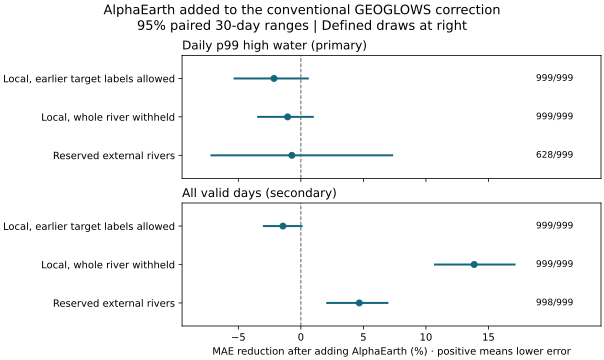
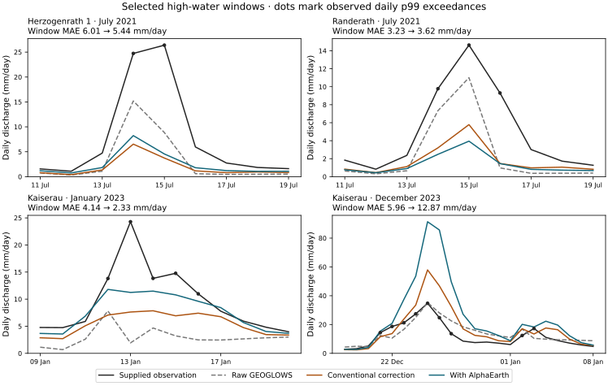

# Limburg AlphaEarth evidence for chapter writing

18 November 2026. Internal writing aid. This completes consolidation of the
AlphaEarth study, Step 4 of the original DISE plan and Step 1 of the
representation extension. The tables and figures use the completed
predictions and repeatability results.

## Main result

- **Primary, daily high water.** Adding AlphaEarth to the conventional
  correction slightly increased mean absolute error (MAE) in all three
  evaluation regimes. The paired ranges include improvements and losses.
  A dependable incremental high-water benefit remains unestablished.
- **Secondary, all days.** Adding AlphaEarth lowered MAE by **13.86%** on
  local rivers withheld from correction fitting and tuning. The improvement
  repeats across all five test years and four of five local rivers.
- **Transfer limits.** With earlier target-river labels available, all-day MAE
  increased by 1.44%. On reserved external rivers it fell by 4.67%, mostly
  because of Erft. Voer and Sieg are counterexamples to uniform improvement.

## Main comparison

MAE is in mm/day. Average within each gauge first, then across gauges within
each river group, then across groups. The conventional correction combines model
and weather history with conventional catchment descriptors (H+A). The
AlphaEarth correction adds 2017 satellite embeddings (H+A+E). Report both the
total correction relative to raw GEOGLOWS and the incremental embedding effect.
Positive reductions mean lower error. Ranges are paired 95% percentiles from
synchronized 30-day blocks within each year, conditional on draws with
verification for every required gauge.

| Evaluation | Days scored | Gauge-days | Raw GEOGLOWS MAE | Conventional MAE | With AlphaEarth MAE | Added AlphaEarth reduction | Paired range | Defined draws |
| --- | --- | ---: | ---: | ---: | ---: | ---: | --- | ---: |
| Local, earlier target labels allowed | High water | 226 | 3.1351 | 2.5437 | 2.5984 | −2.15% | −5.38% to +0.64% | 999/999 |
| Local, whole river withheld | High water | 226 | 3.1351 | 2.8016 | 2.8313 | −1.06% | −3.50% to +1.03% | 999/999 |
| Reserved Ahr/Erft/Sieg | High water | 1,055 | 6.3150 | 5.3733 | 5.4120 | −0.72% | −7.23% to +7.38% | 628/999 |
| Local, earlier target labels allowed | All | 12,362 | 0.5306 | 0.2439 | 0.2474 | −1.44% | −3.04% to +0.14% | 999/999 |
| Local, whole river withheld | All | 12,362 | 0.5306 | 0.3839 | 0.3307 | +13.86% | +10.65% to +17.17% | 999/999 |
| Reserved Ahr/Erft/Sieg | All | 57,133 | 0.6991 | 0.5023 | 0.4789 | +4.67% | +2.03% to +7.00% | 998/999 |

The local regimes score the same gauge-days under different fitting rules.
Their temporal and spatial results should be read separately. The seven local
gauges represent five rivers in 2021–2025. Forty-nine of 50 reserved gauge
records contribute verification in 2021–2024, across three river systems.
The local and external high-water observations span 87 and 122 distinct dates,
respectively. Daily high water uses the gauge's p99 from observed history up
to the year before each test. The threshold is used for evaluation only.



## Robustness and exceptions

| Check | Result and implication |
| --- | --- |
| Local river withheld, all days | The 2021–2025 reductions are 12.47%, 11.75%, 11.48%, 14.32% and 19.57%. Omitting any year or any river leaves a positive pooled estimate. The joint whole-year range is +11.90% to +16.64% (999 defined draws). |
| Local rivers, all days | Geleenbeek +15.93%, Geul +13.27%, Gulp +23.09%, Wurm +18.71%, Voer −8.31%. At high water, Gulp improves 17.00% and the other four worsen. |
| External rivers, all days | Ahr +1.74%, Erft +20.00%, Sieg −0.75%. Omitting Erft leaves +0.18%. The high-overlap and location-consistent subset shows +5.02% all-day and −1.27% at high water. |
| High-water alternatives | Local MAE on strict-clean records increases 4.15% in the temporal regime and 3.39% when a local river is withheld. The article-faithful selection policy gives a small +0.21% local river-withheld high-water reduction while preserving the larger all-day gain (+11.71%). External clean-only analysis is undefined because provider row-level quality is unknown. |
| Large external errors | High-water RMSE rises from 9.44 mm/day for raw GEOGLOWS to 10.15 for conventional correction and 10.57 with AlphaEarth, despite lower high-water MAE for both corrections than for raw GEOGLOWS. |

Whole-year resampling and 14- and 60-day blocks provide sensitivity checks.
For local withheld rivers, the whole-year high-water range is −5.36% to
+1.63% (993/999 draws defined). External high-water and strict-clean local
whole-year resampling leave 364 and 325 draws undefined, respectively,
because some gauges lose all verification in the sampled years. The ranges
describe fixed predictions and observed river populations. Shared dates,
nested gauges, overlapping rolling training histories, limited years and
measurement uncertainty constrain inference to this evaluation.

## Event examples for the write-up

The event ledger contains every evaluable gauge-year maximum and all daily
p99 exceedances grouped within river. It retains 90 local river episodes per
regime and 56 external river episodes. The examples below are deliberately
paired illustrations selected from the saved review index.

| Window | Gauge | Window MAE, conventional → with AlphaEarth (mm/day) | Observed maximum day, supplied → raw → conventional → with AlphaEarth (mm/day) | Interpretation |
| --- | --- | ---: | ---: | --- |
| July 2021, Wurm | Herzogenrath 1 | 6.01 → 5.44 | 26.40 → 8.85 → 3.74 → 4.56 | The incremental correction helps relative to H+A, with a large remaining underestimate. |
| July 2021, Wurm | Randerath | 3.23 → 3.62 | 14.62 → 11.01 → 5.78 → 3.95 | The incremental correction worsens error in the same river episode. |
| January 2023, Sieg | Kaiserau (DEA13190) | 4.14 → 2.33 | 24.29 → 1.93 → 7.63 → 11.24 | AlphaEarth reduces errors but still underestimates the observed maximum day. |
| December 2023, Sieg | Kaiserau (DEA13190) | 5.96 → 12.87 | 34.77 → 35.23 → 57.93 → 91.37 | Both corrections overshoot a close raw estimate on the observed maximum day. |

Both Wurm maximum-day observations fall outside the strict-clean definition.
Kaiserau row-level observation quality is unknown. The last column gives
observed error patterns. Hydrological causes would require separate evidence.
The curves use the original three-day padding on either side of each saved
episode. Vertical scales vary by panel.



## Contribution and agency relevance

- The independent adaptation extends DISE's one-year test to chronological
  and whole-river transfer for GEOGLOWS in the study region. Prior work already
  reports stronger embedding value under spatial transfer. The contribution
  here is the measured extent and limits of that benefit under this correction
  and these held river groups.
- The operationally relevant distinction is between improving routine
  reconstruction where local calibration is unavailable and improving high-water
  assessment. The all-day gain supports the former as a candidate use. Severe
  misses and inconsistent benefits support checking local high-flow performance
  and keeping raw discharge visible when evaluating a correction.
- The evidence concerns retrospective daily specific discharge. An agency
  evaluating warning use would need a separate test with actual forecast inputs,
  warning thresholds and operational timing. The present daily p99 scores
  measure reconstruction error on high observed flows.

## Evidence and reproduction

Primary tables: `paired_effects.csv` and `paired_intervals.csv` under
`results/limburg_dise_repeatability_v1/`. Annual and river omissions are in
`influence.csv`, and the paired examples come from
`symmetric_case_review_index.csv`, `episodes.csv` and the saved Step 2
`predictions.parquet`. The figure script checked all 58 source/output
hashes against the completed Step 3 manifest before reading the evidence.

```sh
.venv-dise/bin/python scripts/281_plot_dise_consolidation.py
```

See the [full repeatability record](limburg-dise-repeatability-2026-11-18.md)
and [contribution assessment](reviews/limburg-dise-contribution-assessment-2026-11-18.md).
The three additional representations are a separate comparison against the
planned enriched conventional baseline. Their incremental effects remain open.
